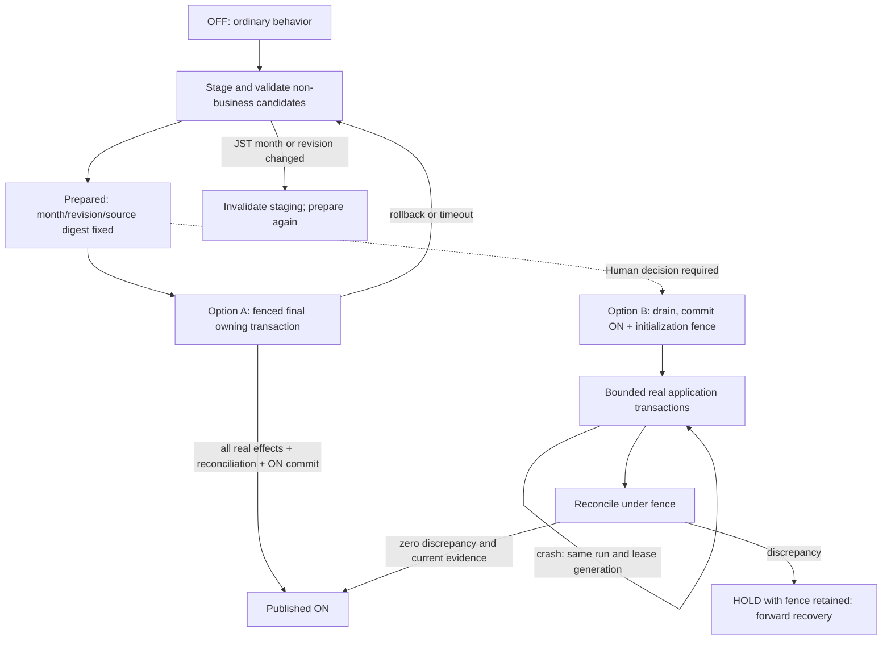

# MEMBERRANK-ACTIVATION — Design Gate / Source HOLD

## Status and authority

Status: `MEMBERRANK_ACTIVATION_SOURCE_HOLD`.
Risk R3; Lane `Strict Change`; Application Runtime Activation `deferred`.
Human decision tracking: [Issue #603](https://github.com/ideal-sol/oripa/issues/603).
This is a design proposal and Source investigation, not implemented activation
behavior, a completed feature, or permission to run a backfill.

Latest Human decision (2026-10-22 JST): investigate option A first and implement
only within demonstrated specification compliance. This is feasibility Source
GO, not a finding that A is safe at all sizes. B and C remain unapproved; do not
fall back automatically. The existing specification, immutable guards, ordinary
409 and independent Hotfix merge/runtime HOLD remain binding. Production-sized
workload and acceptable writer wait budgets are explicitly undecided in the
follow-up Human answer. Investigate 0/100/1000/10000 payments, both a single-user
concentration and multiple users; 100000 is conditional on safe isolated capacity.
Report missing capacity evidence rather than inventing a release threshold.

The Human instruction `MEMBERRANK_ACTIVATION_SOURCE_GO_HOTFIX_HOLD_2026-10-22.md`
authorizes Source work through Draft PR only. Its section 3 explicitly requires
HOLD when scalable activation needs a new interpretation of specification §6.3.
Its PHP Hotfix supplement independently prohibits Ready, merge, auto-merge,
runtime changes and release artifacts until explicit Human Source Merge restart.
Hotfix completion alone does not resolve the design decision below.

Original files were read locally, including the relevant specification sections
6–10 and 14–18; SHA-256 was computed from their bytes:

| Original | SHA-256 | Verification |
| --- | --- | --- |
| 会員ランク機能_仕様書_v1.5_最終統合版_2026-10-15.md | `688c1b727483e22fef1c091a571f6490f30183d46e7d70121367b54d3f3805bc` | Matches supplied authority |
| MEMBER_RANK_PLATFORM_PHASED_IMPLEMENTATION_PLAN_REV2_2026-10-16.md | `b918b3b4ec95b0ce1ceeaf7a5cab2cf601ab4042aeefc41bc263b6171831f633` | Matches supplied authority; historical M1-only instruction superseded |
| MEMBERRANK_ACTIVATION_READONLY_FINDINGS_AND_SOURCE_GO_2026-10-22.md | `52c862fcf231f0897b8194231190690102ab0f35fdad578fc19d4927ad4cffbe` | Computed; Part I is historical observation, not a fresh runtime check |

Root/API/docs AGENTS and the current Governance REV3, Release Gates REV2,
GitHub Operations REV1 and relevant Identity REV1, Data/Point/Payment,
Package/Contract sections were read. See the
[architecture index](../architecture/README.md). No finalized authority changes.

## Source preflight and ownership

| Item | Observed authority |
| --- | --- |
| Repository | `ideal-sol/oripa`; configured origin and live main agree |
| Protected main / origin/main / work base | `c14f35a1fe6c8265e98f1f92849a0d2e25d83e87` |
| Base tree | `b47ddf3b042c5648dcac0a262dc3f47776df0d90` |
| Task branch | `feat/MEMBERRANK-ACTIVATION` |
| Worktree mode | Dedicated; primary and all other task trees preserved |
| PR #600 | Merged Build Control `9fd54a519505a9baa939582e5ed79f4dc52c84b6`; selected Application Payload `c812cb7060f4f1f3c61449b98fe918302f29b196` |
| PR #601 | G1 merged into current main; migration 000095 is consumed |
| PR #602 | Draft G2; head `69da10387608e3d470689035e030488d3bfa0281`; migration 000096 belongs to G2 |
| PR #572 | Draft DB smoke diagnostics; no dependency on its merge |
| Contract | Released alpha.45 immutable; alpha.46 pending, Public/Admin alpha.42 at base |

All registered worktree statuses and open PR summaries were inspected, including
uncommitted work invisible to GitHub. Primary has existing worklog changes and
a nested worktree; other historical tasks have worklogs, test outputs and
first-24h Payment changes. The latter settlement hunk already appears in main;
it was inspected, not imported or modified. Unknown historical artifacts remain
untouched. PR #572's smoke instrumentation and G2's login eligibility/contracts
are outside this document's ownership. A shared filename alone is not a blocker.

The initial checkpoint edited only this memo and its own worklog. The follow-up
also adds one isolated, opt-in feasibility test and registers the exact Human
Change ID in CI metadata with rejection tests. Application services remain unchanged.
Source Lock: none selected for these nonconflicting changes; G2 inline allowlist
and migration inventory hunks are untouched.
Migration Allocation Lock: not acquired; no identifier reserved or source created.
Artifact Release Lock: not acquired; no candidate/ledger edits or publication.
Observed OS locks and durable PR reservations are distinct: an absent OS holder
does not make G2's 000096 available. Re-scan all refs, reservations and lock owners
under the formal allocation lock before any later migration creation. No next
number is assigned here. Deployment/Hotfix locks were not acquired or changed.

## Concrete source findings

| Source at base | Consequence for activation |
| --- | --- |
| `V2MemberRankSettingsService::update` | Revision/idempotency/audit exist; ordinary false→true remains 409 `MEMBER_RANK_ACTIVATION_NOT_READY`; true→false remains forbidden |
| Migration 000088 | CHECK couples enabled with non-null activated_at; trigger prohibits OFF and timestamp changes after ON; this is irreversibility, not proof of completed backfill |
| `V2MemberRankAccountingService::accountGrantedPayment` | Requires outer TX; OFF returns; skips closed/anonymized users, duplicate payment origins, succeeded refund/CB and grants before activation month |
| `consumeReachedEntitlements` and `V2PointService::grantMemberRankPromotion` | Both independently guard OFF; real operation/lot/wallet/ledger/audit are created for a positive bonus; amount zero consumes entitlement without grant |
| `V2MemberRankPurchaseBonusService::grantForPayment` | Requires current grant at/after activated_at and precedes rank accounting; must never be called for retrospective grants |
| `V2MemberRankPaymentAdjustmentService::context` | OFF with a positive rank origin is rejected; ON with a missing activation-month origin is also rejected; hiding UI does not make either intermediate state supported |
| Migration 000094 | Succeeded refund/CB cannot acquire a positive backfill entry; immutable origin/impact/success evidence cannot be rewritten |
| `V2AdminFreshMfaAuthorizer` | authorizePermission validates session/role/permission, not five-minute freshness; validSessionForReauthentication and isFresh are separate |
| `V2MemberRankMonthlyWorker` | Durable monthly job/cursor/60-second lease/finite failure logic exists, but visits rank states rather than historical payments |

M8 current-month deductions clamp to zero and reuse M7 recovery; past-month
adjustments do not recompute current rank. Reversal alone does not restore points
or rank eligibility. A completed OFF adjustment retains its immutable no-rank
effect and excludes that payment from initial backfill.

`payment_point_grants.granted_at` is the month authority. Migration 000089 checks
payment/user/operation/time/amount origins and monthly totals against applied
entries. Wallet is a live balance used outside rank presentation. A supposedly
hidden promotion grant would therefore affect ordinary spending and adjustments.
Changing only the rank API response cannot isolate it.

## Design decision requiring Human disposition

The approved rules require OFF to preserve ordinary behavior, retrospective rank
and real promotion grants, no partial public state, and large resumable batches.
With the current authoritative wallet/lot/ledger model, applying a batch commits
real business state. Non-authoritative staging can be chunked safely, but does
not eliminate the eventual real application work.

No bounded, scalable, fully compliant application protocol has been demonstrated
in this checkpoint. This is not a proof that an atomic solution is impossible.
It is a refusal to silently choose new OFF/ON semantics or to call an unmeasured
single transaction safe. The historical zero-candidate snapshot proves neither.

| Option | Transaction and visibility | Benefit / risk | Decision or proof still required |
| --- | --- | --- | --- |
| A: staging, then atomic application + ON | Commit only non-business staging while OFF. Final owning TX applies every rank/entitlement/point effect, reconciles, records actual activation time and ON, then commits once. Readers never see partial business state. | Closest to §6.3; crash rolls back all real effects. Final work/locks/WAL still grow with eligible payments/users. Chunked staging does not bound this TX. | Prove representative maximum size, lock duration, timeout, audit-chain contention, rollback cost and month-boundary safety. A size cap must not be presented as meeting the unrestricted large-run requirement. |
| B: irreversible ON behind an initialization fence, then bounded application | Drain all participating readers/writers; commit ON/actual activated_at once with durable initialization state; process real effects in bounded TXs; reconcile and release fence atomically. | Supports durable business progress and existing ON-only kernels. Failure after first commit requires forward recovery; ordinary functionality remains blocked until completion. | Explicitly approve ON before full backfill/public availability, affected service unavailability and recovery across JST month boundary. Current instruction explicitly reserves this interpretation to Human. |
| C: real grants while OFF behind a fence, then ON | Commit real rank/wallet/lot effects in batches before ON, keeping all consumers fenced. | Resumable but changes OFF semantics, accrual/expiry timing and M8 readiness assumptions. Hiding balances is insufficient. | Explicit specification change would be required; not recommended. No guard bypass is proposed or authorized. |

Prefer investigating A when a defensible bounded workload can be proved. If
durable business progress for large runs is essential, B needs the explicit
decision above before implementation. C should remain rejected under current
authority. Choosing B is not implicit in Source GO. No implementation path,
feature flag, hidden environment switch or unprotected CLI is added here.

### Proposed state transitions (not implemented)

For A, staging cursor survives; real business progress does not survive an abort.
All real effects and ON are one commit. A private, validated activation domain
context would need to reach shared accounting kernels without removing normal
OFF guards or setting a temporary global ON. This refactor is not yet designed
or tested. `activated_at` must be sampled at the actual activation boundary,
not preflight; month must be checked again before commit. A long transaction
cannot obtain a guaranteed future commit timestamp by guessing.

For B, aborted chunks roll back but prior committed chunks remain. Never reset
enabled, move activated_at, delete history, rewind a completed cursor or restore
the DB to erase grants. If a run crosses a month boundary after irreversible ON,
its activation month cannot be relabeled. Forward completion and any subsequent
monthly catch-up before release require an explicitly approved policy; retain
the fence on uncertainty. The current requirement does not authorize that policy.

## Transaction graph and fence requirements

Current call paths, including outer transactions, were inspected:

| Path | Relevant acquired locks / owning TX |
| --- | --- |
| Payment confirmation | Outer V2PointTransactionRunner; Provider Event → User → Payment → existing Rank state → Plan → Wallet/payment grants; M4 then M2, acquiring further rank/entitlement rows while User remains held |
| Refund completion | Outer runner; User → Payment → Adjustment → shared Settings/readiness → Rank state/month/ordered entitlements → Wallet → ordered lots/reservations |
| Chargeback | Event when applicable → User → Payment → shared Settings/readiness → Rank → Adjustment → Wallet → ordered lots; M8 applies before success commit |
| M9 Admin adjustment | Admin authorization/idempotency wrapper → User → Payment/Adjustment → the same financial methods; nested runner must not retry independently |
| M7 manual operation | Idempotency → User → Rank state/month/ordered entitlements → correction/promotion → Wallet/lots |
| Closure | Idempotency → User → Resolver materialize/freeze → state/session updates within owning TX |
| Lazy materialization | User → Rank state; pure read projection uses a snapshot, not this row-lock path |
| Monthly worker | Job/owner/lease row → one User → Rank; per-user commit couples cursor with judgment |

Do not copy M2/M3's obsolete Payment→User handoff order. Also do not pretend
every current rank subrow is acquired before Wallet: settlement grants paid
points before M4/M2, while holding the serializing User lock. A new activation
writer must account for this actual graph and the global audit chain.

In particular, activation must not lock Settings exclusively and then wait for
User while an existing refund owns User and waits for Settings shared lock.
That creates a new cycle. A proposed durable admission fence must be acquired
and checked by every participating outer entry before it owns business locks;
close admission, drain admitted transactions, then acquire settings/run locks.
Taking a run-row lock alone does not fence any existing writer.

Coverage must include Webhook settlements and replay, M9/provider adjustments,
user close/anonymize paths, M7, lazy writes, monthly workers, draws, wallet/point
spending/expiry/grants, relevant reads and settings changes. Row triggers can
provide a final database barrier but their late acquisition must be tested
against admission ordering; they do not by themselves prove a safe graph.
No existing complete activation fence was found or is claimed implemented.

Only the existing outer V2PointTransactionRunner retries 40001/40P01, at most
three attempts with jitter. Use finite statement/lock budgets per phase; a
timeout leaves a durable retryable/HOLD state. Lease renewal requires an exact
token and increasing generation. Expired owners cannot commit a chunk or open
publication. Numeric budgets need isolated measurements, not invented capacity.

## Persisted evidence, ordering and reconciliation proposal

After the design decision and migration allocation, persist a run identity,
authority/schema version, target JST month and UTC bounds, settings revision
and effective version, source high-water/digest, fence generation, ordered
cursor, candidate/processed/excluded/residual counts and amounts, lease owner/
generation/expiry/heartbeat, audit actor/time and reconciliation outcome.
The initial technical completion record is separate from Human Runtime GO.

Candidate capture must inspect payments, grants and point origins in both
directions; inner joins alone hide orphan records. Validate paid amount, user,
payment status, operation kind, amounts and grant/operation/payment times.
Classify prior-month/unsettled/free/preregistration/manual-point sources as
out-of-scope with bounded evidence. Do not silently repair an inconsistent
eligible origin. Record closed/anonymized exclusion using current M2 policy,
and recheck membership under User lock before applying anything.

Use deterministic `(user_id, granted_at, payment_id)` ordering inside a fixed
candidate set, retaining all same-user causal predecessors. A sequence maximum
is not a commit watermark: a lower-ID in-flight grant can commit after a scan.
Re-scan the complete eligible predicate under the effective writer fence and
compare identities/origins, not just count or MAX(id). Reject stale settings,
month, membership, source digest or generation. Pending adjustments must be
resolved/revalidated or HOLD; do not change their immutable success evidence.

The application transaction reuses M2/M7/Point and M8 rules, never a second
accounting implementation. Preserve zero-bonus entitlement consumption, skipped
rank bonuses, manual high-rank unconsumed entitlements, unique business keys and
180-day free lots. Retrospective payments create no M4 record or purchase grant;
post-publication settlements retain M4's pre-promotion rank calculation.

Completion requires eligible-source difference zero, duplicates zero, monthly
totals equal immutable applied deltas, matching origin references, entitlement/
operation/lot/ledger agreement, no unfinished adjustment or unexplained failure,
and matching audit digest. Zero candidates runs these checks too. Do not use
processed_count=candidate_count as the sole completion condition.

An Admin-only operation is the proposed entry: existing Admin realm, permission
for owner/admin, actual five-minute Fresh MFA, valid session/CSRF, idempotency,
expected revision and explicit audit. Fresh MFA and permissions must be checked
at sensitive execution/resume/finalization boundaries, not assumed from the
authorizer's class name. OpenAPI 3.1.1 and contract tests precede generated Admin
types and Laravel/UI implementation. Ordinary settings PUT retains its 409.
No Public or Storefront activation operation is proposed.

## Verification plan and actual limits

The following are required future real PostgreSQL/Service/API tests, not PASS
claims. Each uses synthetic isolated data, real commits and independent
connections; original constraints and triggers remain enabled.

| Planned test | Required result |
| --- | --- |
| activation_empty_authorization | Zero candidates still require proof; early ON 409; wrong realm/operator/stale MFA/CSRF rejected |
| activation_ordered_large_chunks | Multiple users/payments, tie ordering, bounded progress and concurrent batch ownership without duplicates |
| activation_jst_boundary | Grant-time JST boundaries and delayed notifications; stale-month run cannot publish |
| activation_source_classification | Prior month, unsettled, 500 free points, updated users.created_at and unrelated grants do not count |
| activation_invalid_origin | Orphan/duplicate/mismatched payment-operation-grant time/amount fails closed |
| activation_promotion_entitlements | All crossed bonuses, zero entitlement, manual high rank, uniqueness and 180-day lot origin |
| activation_purchase_bonus_boundary | Retrospective M4 absent; subsequent live settlement gets the pre-promotion bonus |
| activation_crash_resume_fencing | Inject real TX failures; exact committed checkpoint, stale lease and two processes cannot double-apply |
| activation_irreversible_guards | Second ON/OFF/timestamp change and ordinary PUT bypass rejected, including DB constraints |
| activation_adjustment_classification | Succeeded refund/CB excluded; pending→succeeded race deterministic; reversal does not re-add |
| activation_adjustment_concurrency | Refund/CB interleavings preserve zero floor, M8 origins/recovery/review evidence |
| activation_writer_interleavings | Settlement, closure/anonymization, M7, lazy, draw/points and monthly worker serialized correctly |
| activation_finalization_phantom | New settlement between scan and publication detected/fenced; revision/membership/digest stale fails |
| activation_capacity_and_recovery | Measured large-run duration, locks, WAL/memory, lease recovery and bounded retries for chosen protocol |
| activation_publication_regression | Admin/Public/M5/login_daily/signup_once/M6/SMS/F2-B affected behavior verified |
| activation_full_regression | Applicable M1–M9 Backend/Contract/Admin/DB/E2E, fresh migration/inventory/forward-only and final-head checks |

At this checkpoint, application implementation and all activation financial,
database, concurrency, performance, API, Contract, Admin, Browser/E2E tests are
NOT RUN because the application protocol is HOLD. No PHP/DB test environment
was created; no PHP version/image or isolated DB PASS is claimed. Documentation
checks, final SHA, GitHub checks and review evidence belong to the live Draft
PR/worklog record. Other PR test results are not evidence for this Change.

## Runtime handoff and remaining gates

The receiving operator is the existing OLD Test reflection owner. Follow the
existing [monthly worker preparation](../operations/deployment/member-rank-monthly-worker.md)
only after an approved implementation, Source Merge GO, canonical artifact,
separate runtime GO, new backup/restore verification, migration gate, immediate
pre-activation re-aggregation and irreversible Activation GO. No initial
backfill command exists in this proposal. Monthly work is not a substitute.

The future operator binds an exact approved image/OCI revision, site-specific
environment identity, private network, writable storage/cache, worker identity
and approval marker to a dedicated supervised unit. Validate Hotfix acceptance
and prevention of old-PHP rollback separately from synthetic test results.
Do not change the existing P2 candidate, backups, recovery evidence or network
ordering through this Source Change.

Start workers only after successful public activation/reconciliation and a
separate worker permission. For incidents, gracefully stop between users and
restart the same approved image/run under the existing lease rules; never erase
job history or force-reclaim an unexpired owner. Monitor failed jobs, expired
leases, delayed heartbeats, retry/failure growth, remaining eligible states,
cursor stagnation and last completed month, with sanitized audit/log linkage
and an assigned alert recipient. A running process alone is not health.
Real unit installation, alert delivery and restart acceptance remain NOT RUN.

M2/M3/M4/M5 and monthly-worker PERF OPEN items remain open; old measurements
are not representative activation capacity and are not summed or extrapolated.
The specification/M5 disagreement over rank conditions while OFF remains a
Human Final Gate decision. G2 Draft #602 proposes per-Gacha login limits even
after ON; do not import it or write tests assuming it is merged. Recheck the
approved source/authority at integration. Alpha.46 publication and Storefront
adoption remain separate Changes; alpha.45 and its history are unchanged.

No source merge or operational Runtime/DB/Artifact/Feature ON/worker action occurred.
Retain this task branch/worktree for the design decision; no migration or runtime
rollback is needed. Any later persisted financial correction is forward-only.

## A feasibility experiment and evidence boundaries

`apps/api/tests/V2/ZMemberRankActivationFeasibilityTest.php` is an explicitly
opt-in **negative control**, not an activation implementation. It requires the
exact synthetic database, testing environment and a local Unix-socket connection.
The isolated runner supplies no network, credentials, operational environment or
runtime mounts. Ordinary CI skips this opt-in test; a green CI result alone does
not mean this experiment or the full activation matrix ran.

The control uses real existing payment/point/accounting services, actual commits,
all 95 unchanged migrations and existing constraints. It first confirms OFF
accounting has no effects. It then uses the existing test-only ON fixture inside
one transaction to study the explicitly disallowed shortcut, not to adopt it.
Independent connections check uncommitted visibility, complete rollback of rank
and financial effects, deferred commit rejection, timeout after reward creation,
client-disconnect rollback and writer lock contention. A simulated JST month
change before commit tests whether these existing kernels prevent publication
of the old month; immutable timestamp rejection prevents pretending this can be
repaired afterward. This control cannot validate a future private late-ON context.

The initial matrix requests 0/10/1000/10000; the expanded Human-requested matrix
uses 0/100/1000/10000 and one/ten users. Initial fixtures used only real settlement
services. Expanded fixtures seed each user's first payment through real services,
then bulk-clone synthetic payment/operation/paid lot/ledger/grant origins under
unchanged constraints; they are not provider-history or payment throughput tests.
Wallet/lot/ledger sums are checked before measuring actual accounting services.
Fixture creation is separated from measured transactions. The initial 60-second
diagnostic TX window is expanded to 300 seconds to gather more evidence, not to
turn an incomplete run into an acceptance PASS. Statement/lock budgets remain
30/2 seconds; competing ordinary payment, free-grant and refund services use
100ms lock timeout and their measured waits are explicitly timeout-censored.
These are safety limits, **not approved production capacity thresholds**.
Exceeding a budget makes the test INCOMPLETE with the actual count; PHPUnit exit
zero with an Incomplete marker is not capacity PASS.
No extrapolation from partial fixtures or from ON-only kernels to option A is valid.
WAL insertion delta, database-size delta, PHP peak memory, lock count, writer wait,
commit, transaction and rollback durations are diagnostics only; database growth
is not a table-bloat measurement and PHP memory is not PostgreSQL peak RSS.

The test image is PHP8.4.23, immutable image identifier
`sha256:826ab806235ef8aba0a3803caedf688274183b79d3233a35120c01275a119491`;
PostgreSQL17.10 uses
`sha256:cc4c61127125de9f69aa50f7d78b54686576d5d3d835de03128b064d12b97154`.
Each dedicated test container is limited to 0.5 CPU/512 MiB, with no networking or
published ports; PHP mounts only this task source read-only and its isolated
socket. Locked dependency versions/references match all 130 packages. These
restricted, shared-host measurements are not an environment-equivalent load test
and do not establish Hotfix Runtime Technical Acceptance or rollback safety.

Source inspection additionally finds `V2AuditLogService::lockChain()` takes
`pg_advisory_xact_lock(hashtextextended('v2_audit_chain', 0))`. Once the first
promotion audit occurs, a single owning transaction retains this shared global
audit-chain lock until commit/rollback. Chunking a candidate list cannot release
it. A future admission fence must drain existing audit writers as well as
User/Payment/Settings paths; otherwise settings-first and audit-first cycles
remain possible. Removing audit serialization is outside this Change.

The two-process negative control reproduced the audit/User cycle with an actual
payment confirmation: the accounting transaction owns User A and the audit
chain, settlement owns User B and waits for that chain, then accounting requests
User B. PostgreSQL raised 40P01; the existing outer runner retried settlement
successfully (one observed deadlock, 2559.570ms total). The control transaction
rolled back to OFF with no rank or promotion-operation rows; exactly three
ordinary payment grants remained. The test passed18 assertions. This is evidence
against naive lock ordering, not proof that a correctly fenced A is impossible.
Exact-head matrix/check/review evidence is maintained in
[Draft PR #604](https://github.com/ideal-sol/oripa/pull/604).

Until a private late-ON service boundary, complete admission/drain protocol,
reconciliation, real month-boundary publication guard, workload ceiling and
acceptable writer delay are implemented and proven, A remains SOURCE_HOLD.
The negative control does not prove A impossible; it tests why wrapping existing
ON-only services in one transaction is not itself a compliant implementation.
Durable nonfinancial preparation progress and restart-from-zero financial work
remain distinct. The latest Human GO does not authorize changing either meaning.
